# NF1AA3-Activitat-Cracking-de-contrasenyes

## Configuració d'interfícies i xarxa
Configurem els adaptadors de xarxa de les màquines virtuals amb adaptador `xarxa NAT`.

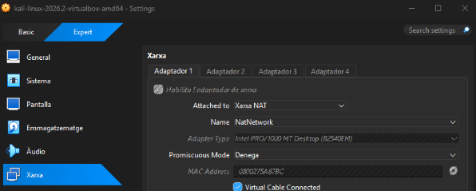
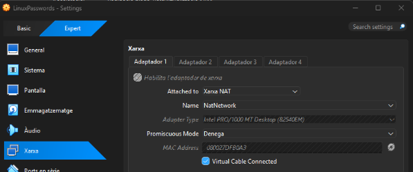

## Activació de SSH
S'activa i s'inicia el servei SSH mitjançant systemctl per permetre l'accés remot.

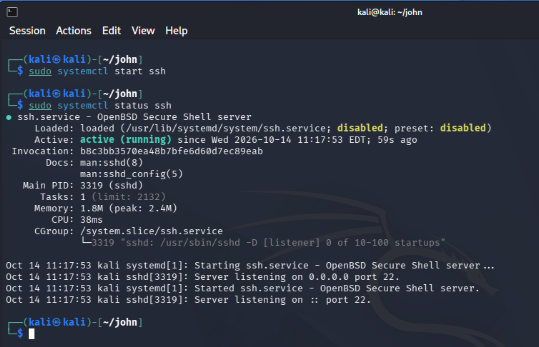

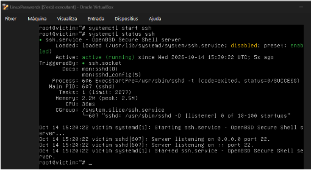

## Transferència d'arxius amb SCP
S'utilitza la comanda scp des de la víctima per transferir de manera remota els fitxers essencials de credencials cap a la Kali Linux.

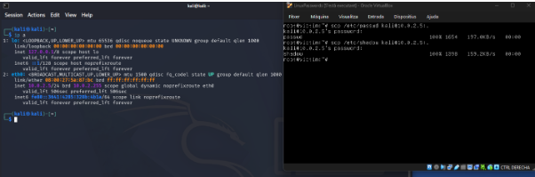

## Instal·lació de John the Ripper
S'instal·len al sistema operatiu les eines de auditoria de contrasenyes John the Ripper i la seva interfície gràfica Johnny utilitzant el gestor de paquets.

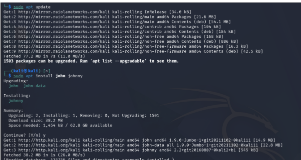

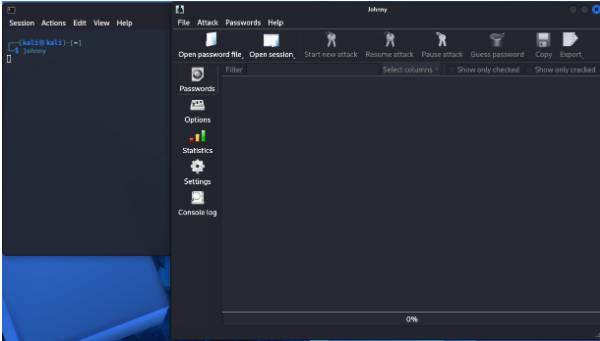

## Fusió de fitxers amb unshadow
Executem la comanda unshadow per fusionar els fitxers passwd i shadow en un de sol que l'eina de cracking pugui processar.

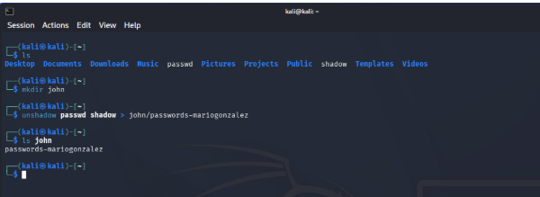

## Obertura de credencials a Johnny i llistat d'usuaris
Carreguem la llista amb tots els usuaris i hashos del sistema.

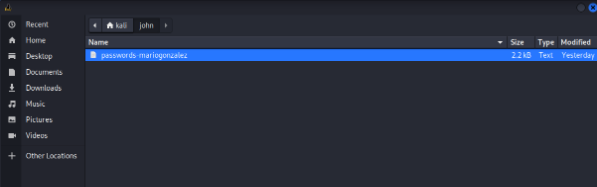

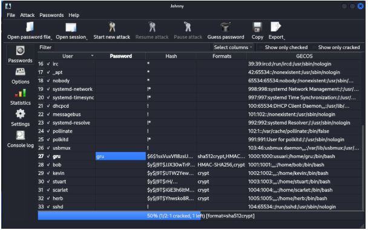

## Descomprimim el diccionari estàndard de contrasenyes.

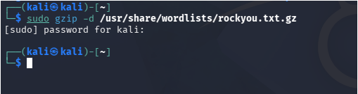

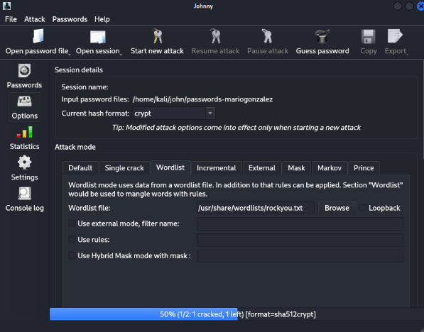

## Resolució de les contrasenyes
Finalment executem el procés de desxifrat indicant l'algoritme de xifratge corresponent per trencar les contrasenyes febles dels usuaris vulnerables.

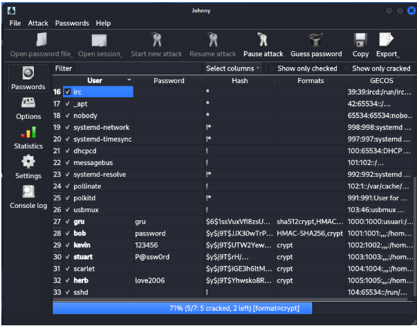

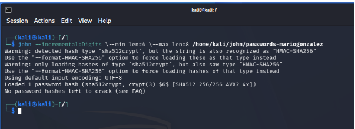

---

## Planteja mesures de millora de la seguretat de l'equip a nivell lògic per evitar que un atacant real pugui replicar el mateix atac i per establir una política de contrasenyes segures.

1. Desactivar l'accés directe de root per SSH.

2. Exigir una longitud mínima de 12 caràcters.

3. Instal·lar programes per bloquejar automàticament les IPs d'atacants després d'intents fallits consecutius.
