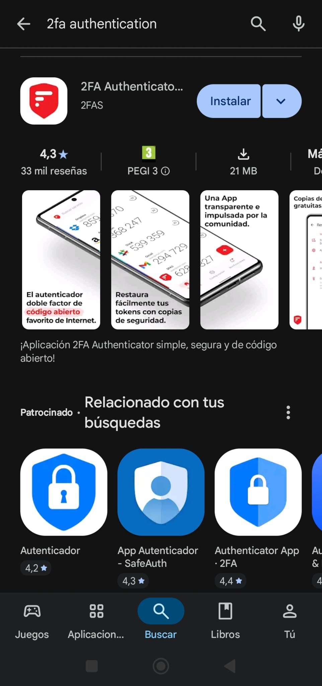
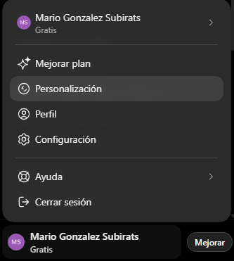
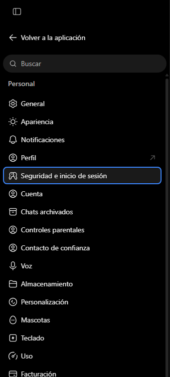
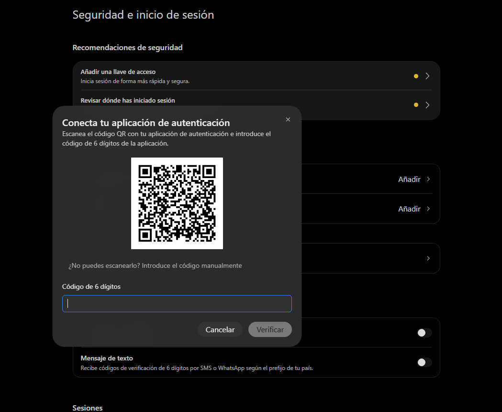
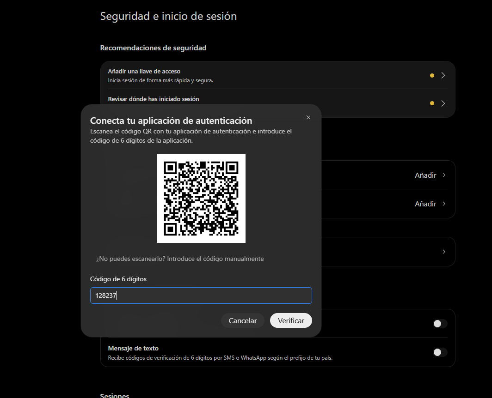
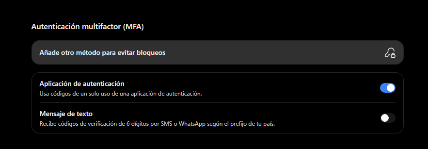

### 1. Buscar la aplicació d'autenticació

Busquem la aplicació 2FA i la descarreguem.

### 2. Instal·lar l'aplicació

Hem de connectar la aplicació amb el lloc on el volem protegir. En aquest cas ChatGpt.

### 3. Configuració

Hem de buscar un lloc que digui "Seguretat i inici de sessió".

### 4. Escanejar el QR

Una vegada ens surt el QR, hem d'obrir l'aplicació i li donem al + i escanegem el QR.

### 5. Codi del servei

Una vegada escanejat, surt un codi. El codi canvia cada 30 segons, i els segons que queden surten a la pantalla.

### 6. Connectar-la al compte

Quan ja hem fet tot, revisem que s'hagi aplicat correctament anant a l'apartat "Aplicació d'autenticació".
